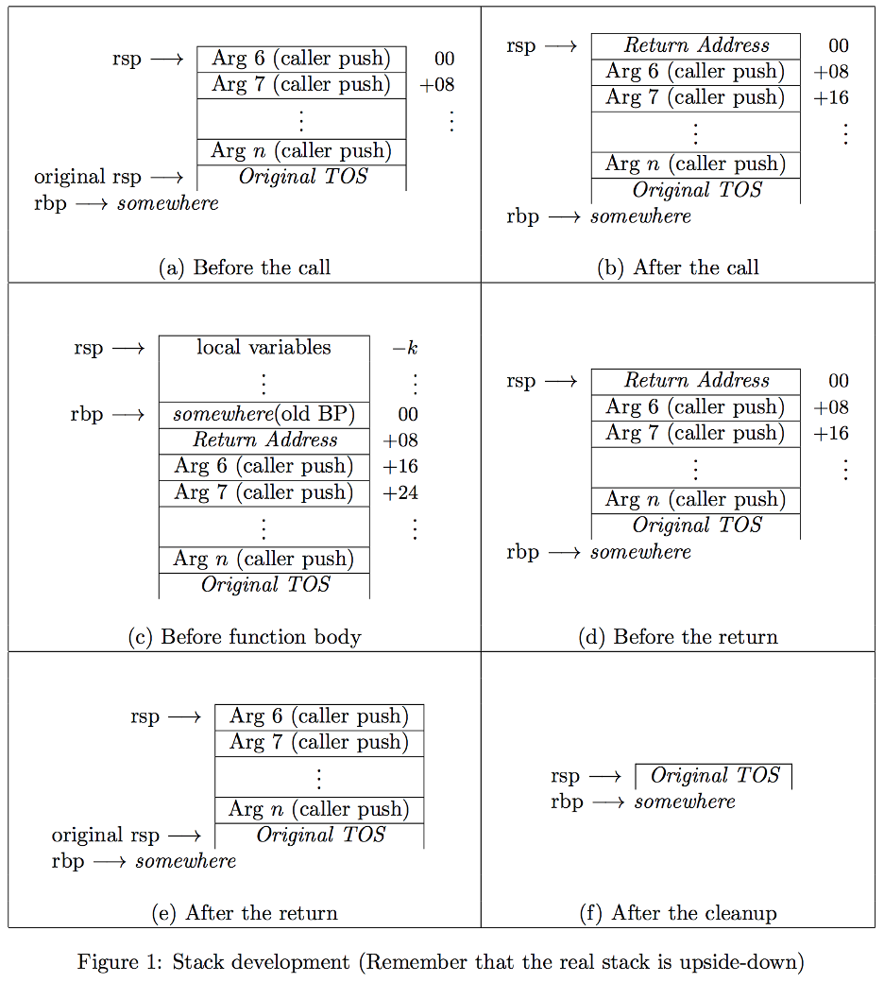

# Programming Assignment 3

# Light Weight Processes (LWP) 	 		 
 
This program requires you to implement support for **lightweight processes (threads)** under Linux using the GNU C Compiler(gcc). A lightweight process is an independent thread of control, sequence of executed instructions, executing in the same address space as other lightweight processes. Here you will implement a **non-preemptive user-level thread package**. 
 
	 
## Light Weight Processes (LWP)  API 
Creating threads is to basically create a library that exposes an API for programs to create, control and run threads. Below are the necessary functions to implement for our LWP API.

| Function | Description |
|---|---|
| `tid_t lwp_create(lwpfun, void*)` | create a new LWP |
| `void lwp_start(void)` | start the LWP system |
| `void lwp_yield(void)` | yield the CPU to another LWP |
| `void lwp_exit(int)` | terminate the calling LWP |
| `tid_t lwp_wait(int*)` | wait for a thread to terminate |
| `tid_t lwp_gettid(void)` | return thread ID of the calling LWP |
| `thread tid2thread(tid_t)` | map a thread to a context |
| `void lwp_set_scheduler(scheduler)` | install a new scheduling function |
| `scheduler lwp_get_scheduler(void)` | find out what the current scheduler is |

## LWP Functions
### `tid_t lwp_create(lwpfun function, void* argument)`
Creates a new lightweight process (thread) which executes the given `function` with the given `argument`. It returns the lightweight thread id of the new thread or `NO_THREAD` if the thread cannot be created.

How do we create threads when we only have one that the kernel gave us (the original system thread)? We’ll just have to share that one. 

`lwp_create` creates a new thread and admits it to the current scheduler. The thread’s resources will consist of a **context** and **stack**, both initialized so that when the scheduler chooses this thread and its context is loaded via `swap_rfiles` it will run the given function. This may be called by any thread.

`function` is a pointer to a function (which is represented in c as just the name of the function without parentheses). This function contains the body of the thread. It is written and defined like a function from any programs using the thread library, but it is actually never called normally from main. 
<!-- It is executed by being returned to. More on this later.  -->

The thread will execute until it either calls `lwp_exit()` or the function returns with a termination status. 

### `void lwp_start(void)`
Starts the LWP system. Converts the calling thread into a LWP and `lwp_yield`s to whichever thread the scheduler chooses.

Starts the threading system by converting the calling thread, the original system thread, into an LWP by allocating a context for it and admitting it to the scheduler, and yields control to whichever thread the scheduler indicates. It is not necessary to allocate a stack for this thread since it already has one. 

The entire thread system starts when `lwp_start()` is called. `lwp_start()` makes sure that we can return to the main program, by saving the main context information. Then it calls the scheduler to find out which thread to run and then runs it. 

### `void lwp_yield(void)`
Yields control to another LWP, based on the scheduler choice. It saves the current LWP's context, picks the next one, restores that thread's context and returns. If there is no next thread, terminates the program.

It causes a thread to yield control back to the thread library, whereupon the library chooses another thread (or maybe the same one) using the round-robin scheduler, and then runs that one.

### `void lwp_exit(int exitval)`
Terminates the current LWP and yields to whichever thread the scheduler chooses. It does not return.

Terminates the calling thread. Its termination status becomes the low 8 bits of the passed integer. The thread’s resources will be deallocated once it is waited for in `lwp_wait()`. Yields control to the next thread using `lwp_yield()`. 

### `tid_t lwp_wait(int* status)`
Waits for a thread to terminate, deallocates its resources, and reports its termination status if `status` is non-`NULL`. Returns the `tid` of the terminated thread or `NO_THREAD`.

Deallocates the resources of a terminated LWP. If no LWPs have terminated and there still exist runnable threads, blocks until one terminates. If status of the terminated thread is non-`NULL`, `*status` is populated with its termination status. Returns the `tid` of the terminated thread or `NO_THREAD` if it would block forever because there are no more runnable threads that could terminate. 

Be careful not to deallocate the stack of the thread that was the original system thread.

`lwp_wait()`, as specified so far, introduces some nondeterminism into our system, e.g., if there are multiple terminated threads, which one is returned or if there are multiple threads waiting when `lwp_wait()` is called, which one does it get? In a real system we may not care, but for a homework it’s really useful if we make the same decisions so we can compare results. So, to that end: When `lwp_wait()` is called, if there exist terminated threads, it will return the oldest one without blocking. That is, it will return terminated threads in FIFO order and the oldest will be the head of the queue. 
 
If there are no terminated threads, the caller of `lwp_wait()` will have to block. Deschedule it (with `sched->remove()`) and place it on a queue of waiting threads. When another thread eventually calls `lwp_exit()` associate it with the oldest waiting thread, the pointer exited may be useful for this, remove it from the queue, and reschedule it (with `sched->admit()`) so it can finish its call to `lwp_wait()`. 
 
The only exception to this blocking behavior is if there are no more threads that could possibly block. In that case `lwp_wait()` just returns `NO THREAD`. The way it can tell is by using the scheduler’s `qlen()` function (below). Most likely the calling thread will still be in the scheduler at the time of this check, so you’re testing for whether `qlen()` is greater than 1. 

### Termination status

A thread’s status consists of a flag indicating whether it is running (`LWP_LIVE`) or terminated (`LWP_TERM`) and an 8-bit integer that can be passed back via `lwp_wait()`. A thread’s termination value is the low 8 bits either of the argument to `lwp_exit()` or of the return value of the thread function. These are combined into a single integer using the macro `MKTERMSTAT()` which is what is passed back by `lwp_wait()`. Macros for dealing with termination statuses shown in table below. 


| Macro | Description |
|---|---|
| `define LWP_LIVE` | status of a live thread |
| `define LWP_TERM` | status of a terminated thread |
| `define MKTERMSTAT(a, b)` | combine status and exit code into an int |
| `define LWPTERMINATED(a)` | true if the status represents a terminated thread |
| `define LWPTERMSTAT(s)` | extracts the exit code from a status |

### `tid_t lwp_gettid(void)`
Returns the `tid` of the calling LWP or `NO_THREAD` if not called by an LWP.

### `thread tid2thread(tid_t)`
Returns the `thread` corresponding to a given thread ID, or `NULL` if the ID is invalid.

### `void lwp_set_scheduler(scheduler sched)`
Causes the LWP package to use the given `sched` to choose the next thread to run. Transfers all threads from the old scheduler to the new one in `next()` order. If `sched` is `NULL`, the library should return to round-robin scheduling.

### `scheduler lwp_get_scheduler(void)`
Returns the pointer to the current scheduler.

## LWP Context

Recall that threads exist in the same memory space as each other, so they share their code and data segments, but each thread needs its **own registers** and **stack** to hold local data, function parameters, and return addresses. 


### LWP Stacks

Every thread needs a stack, and that stack needs to come from somewhere. So far, the only place you know to get memory is `malloc(3)` which allocates to you a hunk of memory in a contiguous heap, meaning that if one stack overflows, it can overflow into neighboring regions. In this section we will look at using `mmap(2)` to create stacks in memory regions that are not connected to each other. 
 
`mmap(2)` is a versatile system call that allows processes to map regions of memory shared with other processes, or to map files directly into their memory spaces bypassing the IO system calls. For our purposes, we’re just going to use `mmap(2)` to create a region of memory for each of our threads to use as a stack. If a thread’s stack overflows, this will generate a `SEGV` when it touches the first unmapped page, but it will not corrupt its neighbors. 
 
To create an anonymous mapping with `mmap(2)`, first read the man page. The prototype for `mmap(2)` is `void *mmap(void *addr, size_t length, int prot, int flags, int fd, off_t offset);` 
 
For our stacks, `addr` should be `NULL` (let mmap(2) choose), `fd` should be `−1` (some implementations require this), and `offset` should be `zero`. We should offer read `PROT_READ` and write permission `PROT_WRITE` (but not execute) and we should have `flags` appropriate to a stack (`MAP_PRIVATE`, `MAP_ANONYMOUS`, and `MAP_STACK`): 
 
`stack = mmap(NULL, stack_size, PROT_READ | PROT_WRITE, MAP_PRIVATE | MAP_ANONYMOUS | MAP_STACK, -1, 0);`
 
`mmap(2)` returns a pointer to the memory region on success or `MAP_FAILED` on failure. 
The remaining question is, how big (`length`) should these stacks be? First, stacks must be a multiple of the memory page size. This can be determined by using `sysconf(3)` to look up the variable `_SC_PAGE_SIZE`. 
 
Now, like `pthreads(7)` we will use the stack size resource limit if it exists. 
To get the value of a resource limit, use `getrlimit(2)`. The limit for stack size is `RLIMIT_STACK`. 
`getrlimit(2)` reports both hard and soft resource limits. Use the soft one. If `RLIMIT_STACK` does not exist or if its value is `RLIM_INFINITY`, choose a reasonable stack size (8MB). 
 
On a sane system, this resource limit will be a multiple of the page size. But what if it’s not? Round up to the nearest multiple of the page size. Now you’ve got your size. Allocate a stack and get on with it. When done with a mapping, it can and should be unmapped using `munmap(2)`. 

Note: The man page talks about mmap(2) being able to create regions that automatically grow downward to support stacks. Don’t bother trying to implement automatically expanding stacks. Just allocate something large, such as 8 MB, for each thread. For this project, that should be plenty of stack space.


### LWP Registers 

The x86-64 CPU (doing only integer arithmetic) has sixteen registers of interest, shown below. 

| Register | Description |
|---|---|
| `rax` | General Purpose A |
| `rbx` | General Purpose B |
| `rcx` | General Purpose C |
| `rdx` | General Purpose D |
| `rsi` | Source Index |
| `rdi` | Destination Index |
| `rbp` | Base Pointer |
| `rsp` | Stack Pointer |
| `r8-15` | General Purpose 8-15 |


Since C has no way of naming registers, I have provided some useful tools below that will allow you to access these registers. The assembly language file, `magic64.S` contains a function  `void swap_rfiles(rfile *old, rfile *new)`. This does two things: 
 
1. if old != NULL it saves the current values of all 16 registers and the floating point state to the struct registers pointed to by old. 
2. if new != NULL it loads the 16 register values and the floating point state contained in the struct registers pointed to by new into the registers. 
 
In this assignment it should never be necessary to load or store a context independently. Always do atomic context switches using `swap_rfiles()`. 
 
To assemble magic64.S, use gcc: 
`gcc -o magic64.o -c magic64.S`


### Floating Point State 
As we said above, in addition to the registers, `swap_rfiles()` also preserves the state of the x87 Floating Point Unit(FPU). This is stored in the last element of the struct rfile, the `struct fxsave` called `fxsave`. This structure holds all the FPU state. 
Important: when you initialize your thread’s register file, you will have to initialize this structure to the predefined value `FPU_INIT` like so:  
`newthread->state.fxsave = FPU_INIT;` 

## The GCC calling convention 

In order to build a context in `lwp_create()` that will do the right thing when loaded and returned-to, you will need to know the process by which stack frames are built up and torn down. 
 
The extra registers available to the x86-64 allow it to pass some parameters in registers. This makes the overall calling convention a little more complicated, but, in practice, it will be easier for your program since you won’t be passing enough parameters to push you out of the registers onto the stack. 
 
This section describes the calling convention which will allow you to both understand and construct the stack frames you will need. These figures show normal stack development. What you will be developing will be distinctly abnormal. 



The steps of the convention are as follows (illustrated in Figures 1a–f): 
  
1. Before the call: Caller places the first six integer arguments into registers `%rdi, %rsi, %rdx, %rcx, %r8, and %r9`. If there are more, they are pushed onto the stack in reverse order. This is shown in the figure, but you won’t encounter more in this assignment.  
2. After the call: The call instruction has pushed the return address onto the stack.
3. Before the function body: Before the body of a function executes it needs to set up its stack frame that will hold any parameters and local variables that will fit into the registers. To do this, it will execute the following two instructions to set up its frame: 
`pushq %rbp`
`movq %rsp,%rbp` 
Then, it adjusts the stack pointer to leave room for any locals it may need. 
4. Before the return: Before returning, the function needs to clean up after itself. To do this, before returning it executes a leave instruction. This instruction is equivalent to:  
`movq %rbp,%rsp`  
`popq %rbp` 
The effect is to rewind the stack back to its state right after the call. 
5. After the return: the Return address has been popped off the stack, leaving it looking just like it did before the call. Remember, the ret instruction, while called “return”, really means “pop the top of the stack into the program counter.” 
6. After the cleanup: Finally, the caller pops off any parameters on the stack and leaves the stack just like it was before. 
 
Note: Intel’s Application Binary Interface specification 1 requires that all stack frames be aligned on a 16 byte boundary. The exact wording is: 
The end of the input argument area shall be aligned on a 16 (32 or 64, if _m256 or _m512 is passed on stack) byte boundary. 
This means that the address of the bottom (lowest in memory) element of the argument area needs to be evenly divisible by 16, even if there isn’t an argument area. That is, the address above the frame’s return address must be evenly divisible by 16 (equivalently, the saved base pointer’s address must be evenly divisible by 16). 
Be aware of this as you build your stacks. If your stack frame is not properly aligned, all you will see is a SEGV. 


## Scheduling

The lwp library’s default scheduling policy is round robin, but client code can install its own scheduler with `lwp_set_scheduler()`. The lwp scheduler type is a pointer to a structure that holds pointers to five functions. These are: 

1. `void init(void)` This is to be called before any threads are admitted to the scheduler. It’s to allow the scheduler to set up. This one is allowed to be NULL, so don’t call it if it is. 
2. `void shutdown(void)` This is to be called when the lwp library is done with a scheduler to allow it to clean up. This, too, is allowed to be NULL, so don’t call it if it is. 
3. `void admit(thread new)` Add the passed thread to the scheduler’s scheduling pool. 
4. `void remove(thread victim)` Remove the passed thread from the scheduler’s scheduling pool. 
5. `thread next()` Return the next thread to be run or NULL if there isn’t one. 
6. `int qlen()` Return the number of runnable threads. This will be useful for `lwp_wait()` in determining if waiting makes sense.

Changing schedulers will involve initializing the new one, pulling out all the threads from the old one (using `next()` and `remove()`) and admitting them to the new one (with `admit()`), then shutting down the old scheduler. 

A note on function pointers: Remember, the name of a function is its address, so you can pass a pointer to a function just by using its name. For example, my round robin scheduler is defined like so: 
`struct scheduler rr_publish = {NULL, NULL, rr_admit, rr_remove, rr_next, rr_qlen};`
`scheduler RoundRobin = &rr_publish;`

Calling a function pointer is just a matter of dereferencing it and applying it to an argument. E.g.: 
`thread nxt;`
`nxt = RoundRobin->next()`

## LWP system architecture
Everything you need is defined in `lwp.h`, `fp.h` and `magic64.S`. 

At the heart of `lwp.h` is the definition of a struct `threadinfo_st` which defines a thread’s context. This contains:
- The thread’s thread ID. This must be a unique integer that stays the same for the lifetime of the thread. It’s what a thread may use to identify itself. (NO_THREAD is defined to be 0 and is always invalid.) You may assume that there will never be more than 2^64 − 2 threads, so a counter is just fine.
- A pointer to the base of the thread’s allocated stack space, the pointer originally returned by mmap(2), see above, so that it can later be unmapped.
- A struct registers that contains a copy of all the thread’s stored registers.
- A status integer that encodes the current status of a thread (running or terminated) and an exit status if terminated.
- Four pointers: 
    - lib_one and lib_two are reserved for the use of the library internally. (E.g., to maintain a global linked list of all valid threads for implementing tid2thread().) 
    - sched_one and sched_two are reserved for use by schedulers, for any purpose or no purpose at all. Most schedulers need to keep lists of threads, so this makes that convenient.
Neither the scheduler nor the library may make any assumptions about what the other is Doing. These, along with each’s stack, hold all the state we need for each thread.


## How to get started?
1.	Write the default round robin scheduler. This consists almost entirely of keeping a list, and then you will have a scheduler.
2.	Start building `lwp_create()`:
    1. Allocate a stack and a context for each LWP.
    2. Initialize the stack frame and context so that when that context is loaded in `swap_rfiles()`, it will properly return to the lwp’s function with the stack and registers arranged as it will expect. This involves making the stack look as if the thread called `swap_rfiles()` and was suspended. How to do this? Figure out where you want to end up, then work backwards through the endgame of `swap_rfiles()` to figure out what you need it to look like when it’s loaded.
    You know that the end of `swap_rfiles()` (and every function) is:
        ```assembly
        leave
        ret
        ```
        And that leave really means:
        ```assembly
        movq %rbp, %rsp 	; copy base pointer to stack pointer
        popq %rbp           ; pop the stack into the base pointer
        ``` 		
        and ret means pop the instruction pointer, so the whole thing becomes:
        ```assembly
        movq %rbp, %rsp 	; copy base pointer to stack pointer
        popq %rbp 		    ; pop the stack into the base pointer
        popq %rip 		    ; pop the stack into the instruction pointer
        ```
    3. `admit()` the new thread to the scheduler.

3.	When `lwp_start()` is called
    1. Transform the calling thread, the original system thread, into a LWP. Do this by creating a context for it and `admit()`ing it to the secheduler, but don’t allocate a stack for it. Use the stack it already has. Make sure not to deallocate this later (leave it NULL in the context or flag it some other way).
    2. `lwp_yield()` to whichever thread the scheduler picks
    3. The idea here is that once the original system thread calls `lwp_start()` it is transformed into just another thread (other than that you shouldn’t free its stack). From here on out, the system continues until there are no more runnable threads.

Remember, what you are trying to do is to build a context so that when `lwp_yield()` selects it, loads its registers, and returns, it starts executing the thread’s very first instruction with the stack pointer pointing to a stack that looks like it had just been called. If the arguments fit into registers (and they will in this case), the stack will only have a return address. 
But what is this return address? It’s supposed to be the place where the thread function should
go “back” to after it’s done, but it didn’t come from anywhere. You could use `lwp_exit()`. That way either it calls `lwp_exit()` or it returns there, but one way or the other when it’s done, `lwp_exit()` will be called.
Note: I’m often asked, what is this “original TOS”? This is the alleged past of this thread. Of
course, it doesn’t have a past, so it doesn’t exist. This thread came from nowhere.

The termination of the thread function poses an interesting challenge: If it calls `lwp_exit()` with an exit status, all is well and it’s clear how to proceed. But what it it doesn’t? If the thread function returns, the value that it returns is supposed to become its exit status. If we simply return to `lwp_exit()` as suggested above, the return value is in the location where return values are to be found (`%rax`) rather than in the register where `lwp_exit()` will look for its argument (`%rdi`).

No amount of stack trickery will get us what we want here. The easiest way to deal with this is to remember that you are a programmer: Instead of invoking the thread function directly, wrap it in a little function that calls the thread function with its argument, then calls `lwp_exit()` with the result. (This is, in fact, completely analogous to how `main()` is called. The process really begins with `start()`.)

```c
static void lwp_wrap(lwpfun fun, void* arg) {
    /* 
     * Call the given function with the given argument
     * Call lwp_exit() with its return value
    */
    int rval;
    rval = fun(arg);
    lwp_exit(rval);
}
```

## Notes
1. A segmentation violation may mean
    1. a stack overflow
    2. stack corruption
    3. an attempt to access a stack frame that is not properly aligned
    4. all the other usual causes

2. If you want to find out what your compiler is really doing, use the gcc -S switch to dump the assembly output. `gcc -S foo.c` will produce foo.s containing all the assembly. 

3. Remember that stacks start in high memory and grow towards low memory.

4. Also remember that pointer arithmetic is done in terms of the size of the thing pointed-to.

5. The stack member of the context structure is an unsigned long *, this makes it easy to treat the stack as an array of unsigned longs and index it accordingly.

6. Despite the fact that it is possible to load and save contexts independently, don’t do it. The compiler feels free—rightly—to move the stack pointer to allocate or deallocate local storage on the stack. If you save your context in one place and load it in another, your thread will go through a time warp and saved data may be corrupted. Use swap_rfiles to perform an atomic context switch.

7. Finally, remember that there doesn’t have to be a next thread. If `sched->next()` returns `NULL`, `lwp_yield()` will exit.

## Supplied Code
There are several pieces of supplied code along with this assignment that can be copied from this location on the CSC Unix systems:

```bash
cp ~pn-cs453/Given/Asgn2 . 					[ original version ]
cp ~foaad/www/class/453/program2_single_directory .	[ single directory ]
```

```c
#ifndef LWPH
#define LWPH
#include <sys/types.h>

#ifndef TRUE
#define TRUE 1
#endif
#ifndef FALSE
#define FALSE 0
#endif


#if defined(__x86_64)
#include "fp.h"
typedef struct __attribute__ ((aligned(16))) __attribute__ ((packed))
registers {
  unsigned long rax;            /* the sixteen architecturally-visible regs. */
  unsigned long rbx;
  unsigned long rcx;
  unsigned long rdx;
  unsigned long rsi;
  unsigned long rdi;
  unsigned long rbp;
  unsigned long rsp;
  unsigned long r8;
  unsigned long r9;
  unsigned long r10;
  unsigned long r11;
  unsigned long r12;
  unsigned long r13;
  unsigned long r14;
  unsigned long r15;
  struct fxsave fxsave;   /* space to save floating point state */
} rfile;
#else
  #error "This only works on x86 for now"
#endif

typedef unsigned long tid_t;
#define NO_THREAD 0             /* an always invalid thread id */

typedef struct threadinfo_st *thread;
typedef struct threadinfo_st {
  tid_t         tid;            /* lightweight process id  */
  unsigned long *stack;         /* Base of allocated stack */
  size_t        stacksize;      /* Size of allocated stack */
  rfile         state;          /* saved registers         */
  unsigned int  status;         /* exited? exit status?    */
  thread        lib_one;        /* Two pointers reserved   */
  thread        lib_two;        /* for use by the library  */
  thread        sched_one;      /* Two more for            */
  thread        sched_two;      /* schedulers to use       */
  thread        exited;         /* and one for lwp_wait()  */
} context;

typedef int (*lwpfun)(void *);  /* type for lwp function */

/* Tuple that describes a scheduler */
typedef struct scheduler {
  void   (*init)(void);            /* initialize any structures     */
  void   (*shutdown)(void);        /* tear down any structures      */
  void   (*admit)(thread new);     /* add a thread to the pool      */
  void   (*remove)(thread victim); /* remove a thread from the pool */
  thread (*next)(void);            /* select a thread to schedule   */
  int    (*qlen)(void);            /* number of ready threads       */
} *scheduler;

/* lwp functions */
extern tid_t lwp_create(lwpfun,void *);
extern void  lwp_exit(int status);
extern tid_t lwp_gettid(void);
extern void  lwp_yield(void);
extern void  lwp_start(void);
extern tid_t lwp_wait(int *);
extern void  lwp_set_scheduler(scheduler fun);
extern scheduler lwp_get_scheduler(void);
extern thread tid2thread(tid_t tid);

/* for lwp_wait */
#define TERMOFFSET        8
#define MKTERMSTAT(a,b)   ( (a)<<TERMOFFSET | ((b) & ((1<<TERMOFFSET)-1)) )
#define LWP_TERM          1
#define LWP_LIVE          0
#define LWPTERMINATED(s)  ( (((s)>>TERMOFFSET)&LWP_TERM) == LWP_TERM )
#define LWPTERMSTAT(s)    ( (s) & ((1<<TERMOFFSET)-1) )

/* prototypes for asm functions */
void swap_rfiles(rfile *old, rfile *new);
#endif
```
**lwp.h**

```c
#ifndef FPH
#define FPH

#include <stdint.h>

/* the saved state for the floating point unit, as defined at
 * http://www.intel.com/content/dam/www/public/us/en/documents/manuals/\
       64-ia-32-architectures-software-developer-manual-325462.pdf
 * This area must be 16-byte aligned.
 */
#if defined(__x86_64)
struct __attribute__ ((aligned(16))) __attribute__ ((__packed__)) fxsave {
  #ifdef  __clang__
  uint8_t all[512];
  #else
  uint16_t pad1;
  uint16_t cs_ip_bits;
  uint32_t fpu_ip_bits;
  uint16_t fop;
  uint8_t  pad2;
  uint8_t  ftw;
  uint16_t fsw;
  uint16_t fcw;
  uint32_t mxcsr_mask;
  uint32_t mxcsr;
  uint16_t pad3;
  uint16_t fpu_dp_bits_high;
  uint32_t fpu_dp_bits_low;

  uint8_t padst0[6]; __float80 st0;
  uint8_t padst1[6]; __float80 st1;
  uint8_t padst2[6]; __float80 st2;
  uint8_t padst3[6]; __float80 st3;
  uint8_t padst4[6]; __float80 st4;
  uint8_t padst5[6]; __float80 st5;
  uint8_t padst6[6]; __float80 st6;
  uint8_t padst7[6]; __float80 st7;

  __float128 xmm0;
  __float128 xmm1;
  __float128 xmm2;
  __float128 xmm3;
  __float128 xmm4;
  __float128 xmm5;
  __float128 xmm6;
  __float128 xmm7;
  __float128 xmm8;
  __float128 xmm9;
  __float128 xmm10;
  __float128 xmm11;
  __float128 xmm12;
  __float128 xmm13;
  __float128 xmm14;
  __float128 xmm15;
  uint8_t pad4[48];         /* For safety.  Manual says it's 512 bytes */
  #endif
};

/* This was captured from a live FPU.  All of these bits are probably not
 * necessary, but that's a task for another day.
 */
#define FPU_INIT ((union {  struct fxsave fxsave;  uint8_t array[512];} ) \
  {.array={\
     0x7f,0x03,0x00,0x00,0x00,0x00,0x00,0x00,\
     0x00,0x00,0x00,0x00,0x00,0x00,0x00,0x00,\
     0x00,0x00,0x00,0x00,0x00,0x00,0x00,0x00,\
     0x80,0x1f,0x00,0x00,0xff,0xff,0x00,0x00,\
     0x00,0x00,0x00,0x00,0x00,0x00,0x00,0x00,\
     0x00,0x00,0x00,0x00,0x00,0x00,0x00,0x00,\
     0x00,0x00,0x00,0x00,0x00,0x00,0x00,0x00,\
     0x00,0x00,0x00,0x00,0x00,0x00,0x00,0x00,\
     0x00,0x00,0x00,0x00,0x00,0x00,0x00,0x00,\
     0x00,0x00,0x00,0x00,0x00,0x00,0x00,0x00,\
     0x00,0x00,0x00,0x00,0x00,0x00,0x00,0x00,\
     0x00,0x00,0x00,0x00,0x00,0x00,0x00,0x00,\
     0x00,0x00,0x00,0x00,0x00,0x00,0x00,0x00,\
     0x00,0x00,0x00,0x00,0x00,0x00,0x00,0x00,\
     0x00,0x00,0x00,0x00,0x00,0x00,0x00,0x00,\
     0x00,0x00,0x00,0x00,0x00,0x00,0x00,0x00,\
     0x00,0x00,0x00,0x00,0x00,0x00,0x00,0x00,\
     0x00,0x00,0x00,0x00,0x00,0x00,0x00,0x00,\
     0x00,0x00,0x00,0x00,0x00,0x00,0x00,0x00,\
     0x00,0x00,0x00,0x00,0x00,0x00,0x00,0x00,\
     0x00,0x00,0x00,0x00,0x00,0x00,0x00,0x00,\
     0x00,0x00,0x00,0x00,0x00,0x00,0x00,0x00,\
     0x25,0x25,0x25,0x25,0x25,0x25,0x25,0x25,\
     0x25,0x25,0x25,0x25,0x25,0x25,0x25,0x25,\
     0x00,0x00,0x00,0x00,0x00,0x00,0x00,0x00,\
     0x00,0x00,0x00,0x00,0x00,0x00,0x00,0x00,\
     0x00,0x00,0x00,0x00,0x00,0x00,0x00,0x00,\
     0xff,0x00,0x00,0x00,0x00,0xff,0x00,0x00,\
     0x00,0x00,0x00,0x00,0x00,0x00,0x00,0x00,\
     0x00,0x00,0x00,0x00,0x00,0x00,0x00,0x00,\
     0x00,0x00,0x00,0x00,0x00,0x00,0x00,0x00,\
     0x00,0x00,0x00,0x00,0x00,0x00,0x00,0x00,\
     0x00,0x00,0x00,0x00,0x00,0x00,0x00,0x00,\
     0x00,0x00,0x00,0x00,0x00,0x00,0x00,0x00,\
     0x00,0x00,0x00,0x00,0x00,0x00,0x00,0x00,\
     0x00,0x00,0x00,0x00,0x00,0x00,0x00,0x00,\
     0x00,0x00,0x00,0x00,0x00,0x00,0x00,0x00,\
     0x00,0x00,0x00,0x00,0x00,0x00,0x00,0x00,\
     0x00,0x00,0x00,0x00,0x00,0x00,0x00,0x00,\
     0x00,0x00,0x00,0x00,0x00,0x00,0x00,0x00,\
     0x00,0x00,0x00,0x00,0x00,0x00,0x00,0x00,\
     0x00,0x00,0x00,0x00,0x00,0x00,0x00,0x00,\
     0x00,0x00,0x00,0x00,0x00,0x00,0x00,0x00,\
     0x00,0x00,0x00,0x00,0x00,0x00,0x00,0x00,\
     0x00,0x00,0x00,0x00,0x00,0x00,0x00,0x00,\
     0x00,0x00,0x00,0x00,0x00,0x00,0x00,0x00,\
     0x00,0x00,0x00,0x00,0x00,0x00,0x00,0x00,\
     0x00,0x00,0x00,0x00,0x00,0x00,0x00,0x00,\
     0x00,0x00,0x00,0x00,0x00,0x00,0x00,0x00,\
     0x00,0x00,0x00,0x00,0x00,0x00,0x00,0x00,\
     0x00,0x00,0x00,0x00,0x00,0x00,0x00,0x00,\
     0x00,0x00,0x00,0x00,0x00,0x00,0x00,0x00,\
     0x00,0x00,0x00,0x00,0x00,0x00,0x00,0x00,\
     0x00,0x00,0x00,0x00,0x00,0x00,0x00,0x00,\
     0x00,0x00,0x00,0x00,0x00,0x00,0x00,0x00,\
     0x00,0x00,0x00,0x00,0x00,0x00,0x00,0x00,\
     0x00,0x00,0x00,0x00,0x00,0x00,0x00,0x00,\
     0x00,0x00,0x00,0x00,0x00,0x00,0x00,0x00,\
     0x00,0x00,0x00,0x00,0x00,0x00,0x00,0x00,\
     0x00,0x00,0x00,0x00,0x00,0x00,0x00,0x00,\
     0x00,0x00,0x00,0x00,0x00,0x00,0x00,0x00,\
     0x00,0x00,0x00,0x00,0x00,0x00,0x00,0x00,\
     0x00,0x00,0x00,0x00,0x00,0x00,0x00,0x00,\
     0x00,0x00,0x00,0x00,0x00,0x00,0x00,0x00}}).fxsave
#else
  #error "This only works on x86_64 for now"
#endif

#endif
```
**fp.h**


```c

#ifdef __APPLE__
	#define FNAME _swap_rfiles
#else				/* everyone else */
	#define FNAME swap_rfiles
#endif

	.text
	.globl FNAME
	#ifndef __APPLE__
	.type  swap_rfiles, @function
	#endif	
  FNAME:
	# void swap_rfiles(rfile *old, rfile *new)
	#
	# "old" will be in rdi
	# "new" will be in rsi
	#
	pushq %rbp		# set up a frame pointer
	movq %rsp,%rbp
	
	# save the old context (if old != NULL)
	cmpq	$0,%rdi
	je load

	movq %rax,   (%rdi)	# store rax into old->rax so we can use it

	# Now store the Floating Point State
	leaq 128(%rdi),%rax	# get the address
	fxsave (%rax)	

	movq %rbx,  8(%rdi)	# now the rest of the registers
	movq %rcx, 16(%rdi)	# etc.
	movq %rdx, 24(%rdi)
	movq %rsi, 32(%rdi)
	movq %rdi, 40(%rdi)
	movq %rbp, 48(%rdi)	
	movq %rsp, 56(%rdi)
	movq %r8,  64(%rdi)
	movq %r9,  72(%rdi)
	movq %r10, 80(%rdi)
	movq %r11, 88(%rdi)
	movq %r12, 96(%rdi)
	movq %r13,104(%rdi)
	movq %r14,112(%rdi)
	movq %r15,120(%rdi)

	# load the new one (if new != NULL)
load:	cmpq	$0,%rsi
	je done

	# First restore the Floating Point State
	leaq 128(%rsi),%rax	# get the address
	fxrstor (%rax)
	
	movq    (%rsi),%rax	# retreive rax from new->rax
	movq   8(%rsi),%rbx	# etc.
	movq  16(%rsi),%rcx
	movq  24(%rsi),%rdx
	movq  40(%rsi),%rdi
	movq  48(%rsi),%rbp
	movq  56(%rsi),%rsp
	movq  64(%rsi),%r8 
	movq  72(%rsi),%r9 
	movq  80(%rsi),%r10
	movq  88(%rsi),%r11
	movq  96(%rsi),%r12
	movq 104(%rsi),%r13
	movq 112(%rsi),%r14
	movq 120(%rsi),%r15
	movq  32(%rsi),%rsi	# must do rsi last, since it's our pointer

done:	leave
	ret
	
```
**magic64.S**
## Submission
You should submit all of your header, source files along with a makefile.  Your program must compile and run on the department general use servers.  

> **Source & Acknowledgment:** This assignment is reproduced from Professor Foaad Khosmood. The assignment originally by Dr. Nico is adopted from versions by Dr. Bellardo and Nico, Cal Poly Computer Science.	